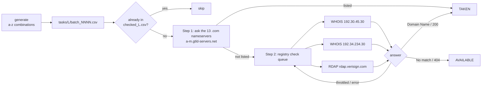

# Short Domain Hunter

Finds unregistered **3-letter and 4-letter `.com` domains** (letters `a–z` only). It checks every possible name against the official `.com` registry and avoids getting blocked by the registry servers.

- Every name is checked, not a sample: 17,576 three-letter and 456,976 four-letter names.
- It is fast: all 456,976 four-letter names took about 11 minutes.
- It is gentle on the registry servers. Each server gets at most one query every 0.5 s, and a server that throttles is paused with increasing waits (10 s, 20 s, up to 160 s).
- Runs can be resumed. Every result is saved to disk as it comes in, so a stopped run continues where it left off.
- It needs only Python 3.8+ and no extra packages.

---

## Quick start

```bash
# 1. Write all names and split them into batches of 1,000
python domain_hunter.py generate -l 3        # or -l 4

# 2. Check them (can be resumed; Ctrl+C is safe)
python domain_hunter.py run -l 3             # all batches
python domain_hunter.py run -l 4 --batch 12  # only batch 12
```

| Option | Default | Meaning |
|---|---|---|
| `-l, --length` | `3` | Name length (3 or 4) |
| `--batch-size` (generate) | `1000` | Names per batch file |
| `--batch` (run) | all | Run only this batch number |
| `--dns-threads` (run) | `50` | Parallel queries to the `.com` nameservers |

### Output files

| File | Contents |
|---|---|
| `domains_<L>.csv` | Every possible name |
| `tasks/<L>/batch_NNNN.csv` | The same names split into batches |
| `checked_<L>.csv` | One row per checked name: `domain,status,source,checked_at`. Kept between runs, so checked names are skipped next time. |
| `available_<L>.csv` | Names the registry reports as not registered |
| `hunt_<L>.log` | Console output, if you redirect it to a file |

`generate` also reads `[TAKEN]` / `[AVAILABLE]` lines from older `scan_*.log` files, so those names are not checked again.

---

## How it works



### Step 1: ask the `.com` nameservers

For each name, the script asks one of the 13 `.com` nameservers (listed on the [IANA page for .com](https://www.iana.org/domains/root/db/com.html)) for the name's nameserver (NS) record. The query is built by hand and sent over UDP:

- **Name found:** the domain is registered and has nameservers, so it is marked **TAKEN**.
- **Name not found (NXDOMAIN):** the domain is either free or registered without nameservers (for example, on hold). It goes to step 2.

Queries are spread randomly across the 13 servers, and each name gets up to 3 tries on different servers.

### Step 2: check the registry

Every name that wasn't found in step 1 goes into one shared queue. Three workers, one per registry server, take names from it at the same time:

| Server | Free | Registered | Throttled |
|---|---|---|---|
| WHOIS `whois.verisign-grs.com` (2 IPs), TCP port 43, query `domain <name>` | `No match for` | `Domain Name:` | `throttled` / `rate limit` text |
| RDAP `https://rdap.verisign.com/com/v1/domain/<name>` | HTTP 404 | HTTP 200 | HTTP 429 |

Each worker:
- waits at least **0.5 s** between its own queries;
- when throttled, puts the name back in the queue and pauses **only its own server** (10 s → 20 s → … → 160 s), while the other workers continue;
- marks a name **FAILED** after 5 unsuccessful tries. FAILED names are checked again on the next run.

---

## Analysis

### Results (run on 2026-10-14)

| | 3 letters | 4 letters |
|---|---:|---:|
| Possible names | 17,576 | 456,976 |
| Registered according to the nameservers (step 1) | 17,052 | 455,676 |
| Sent to the registry check (step 2) | 26 (+498 from the earlier scan log) | 1,300 |
| Registry: registered | 26 (19 WHOIS, 7 RDAP) | 1,297 (859 WHOIS, 438 RDAP) |
| **Registry: not registered** | **0** | **3** |
| Failed / throttled | 0 / 0 | 0 / 0 |
| Run time | ~51 s | ~11 min |

**Not registered (4 letters):** `gnso.com`, `iesg.com`, `imso.com`

All three were checked again in three separate ways: missing from the nameservers, WHOIS `No match`, and RDAP 404. They are almost certainly **reserved by the registry rather than buyable**:

- **GNSO** is ICANN's Generic Names Supporting Organization.
- **IESG** is the IETF's Internet Engineering Steering Group.
- **IMSO** is the International Mobile Satellite Organization, an intergovernmental organization.

ICANN's registry agreements reserve names like these, and the registry reports reserved names the same way as free ones. Check them at a registrar before relying on them.

**Conclusion:** every letters-only 3-letter `.com` is registered. Every letters-only 4-letter `.com` is registered or almost certainly reserved.

### What was learned along the way

1. **Checking whether a name has a website address is a poor filter.** The first version (`domain_scanner.py`) used `socket.gethostbyname`, which asks whether the name has an IP address. About **10 %** of 3-letter names (e.g. `api.com`, `bar.com`, `ark.com`) have no address but are still registered, so they all went to WHOIS unnecessarily. Asking the `.com` nameservers whether the name is registered at all cut that to **0.15 %** (26 of 17,576) for 3 letters and **0.28 %** (1,300 of 456,976) for 4 letters.

2. **The Windows address lookup was the bottleneck.** With 200 threads, `gethostbyname` managed only about **4 names/s**, because each unknown name waited for Windows' own timeouts. Sending raw queries to the `.com` nameservers handled about **1,000 names/s**, roughly 250× faster.

3. **Every WHOIS query was quietly waiting on the same address lookup.** `socket.create_connection(host)` calls `getaddrinfo` on every connect, even when given an IP address. That call waited in the same queue as the 200 threads looking up domain names, so 13 WHOIS queries took more than 30 s. Looking up the WHOIS server's address once and connecting with a plain socket fixed it.

4. **A 0.5 s delay in the main thread didn't slow the workers.** In the original script, `time.sleep()` ran in the loop that collected finished results, after all tasks had already been handed to the workers. Pacing now happens inside each worker.

5. **Verisign's "not found" wording changes with the query.** A plain query returns `No match for "X.COM".`; a `domain X.COM` query returns `No match for domain "X.COM".` Matching on `No match for` covers both. The original check for `No match for domain` only matched the second form.

6. **Showing results only after all DNS lookups finish hides progress.** Running DNS for everything first and WHOIS afterwards meant no WHOIS result appeared for about an hour. Batches of 1,000 names show progress within seconds.

7. **Using several registry servers at once doubles the throughput.** Two WHOIS IPs plus RDAP gave three independent query streams, about 6 queries/s in total. None of them throttled during the 4-letter run.

### Other scripts

- **[hacder/python-short-domain-finder](https://github.com/hacder/python-short-domain-finder)** (2013): Python 2 only, uses the old server name `whois.crsnic.net`, runs on a single thread with no rate limiting, and ignores errors, so a throttled or failed query is counted as "taken". It also reports the total number checked where it means the number available. This project avoids all of those problems.

---

## Files in this repository

| File | Purpose |
|---|---|
| `domain_hunter.py` | Main tool (generate + run, two-step, resumable) |
| `domain_scanner.py` | First version: address lookup, then WHOIS, run together |
| `available_3.csv`, `available_4.csv` | Results |

Generated data (`domains_*.csv`, `checked_*.csv`, `tasks/`, logs) is not stored in Git; `generate` and `run` recreate it.

## Ideas for future work

- Allow digits and hyphens (`[a-z0-9-]`): 47,952 three-character and 1,774,224 four-character names.
- Try 5 letters (11,881,376 names); step 1 alone would take about 3–4 hours at the current speed.
- Support other endings (`.io`, `.ai`, `.co`, …). This needs each ending's nameserver list and WHOIS/RDAP servers from the IANA root zone database.

## Responsible use

Use public registry services politely. Keep the delays and backoff as they are, and don't use this tool to collect registration data in bulk. Verisign's WHOIS terms forbid high-volume automated queries for marketing or for sending unsolicited messages.

---

<h2 align="center">⭐ Star IT. ⭐</h2>
<p align="center"><i>If this saved you some time, give the repo a star!</i></p>
